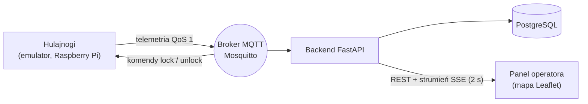

# Platforma IoT do zarządzania flotą hulajnóg elektrycznych

Praca inżynierska – Informatyka Przemysłowa, Uniwersytet Pomorski w Słupsku.

**Temat:** *Projekt i implementacja platformy IoT do zarządzania flotą pojazdów mikromobilności
z wykorzystaniem telemetrii w czasie rzeczywistym.*
(rozszerzenie tematu „Hulajnogą po mieście. System obsługi wypożyczeń hulajnóg elektrycznych”)

## Problem i cel

Jak niezawodnie przyjmować, zapisywać i analizować strumień telemetrii z wielu pojazdów o zmiennej
jakości łączności oraz reagować na zdarzenia (geostrefy, rozładowanie baterii, utrata łączności)
w czasie rzeczywistym? Celem pracy jest zaprojektowanie i implementacja takiej platformy oraz
zbadanie jej opóźnień i przepustowości.

## Architektura



- **Emulator** (`emulator/`) – symuluje flotę w 3 miastach (Słupsk, Gdańsk, Warszawa); można też uruchomić
  na Raspberry Pi jako pojedynczy węzeł.
- **Backend** (`backend/`) – subskrybuje telemetrię, zapisuje stan i historię, wylicza geostrefy i alerty,
  obsługuje rezerwacje i wypożyczenia (pauza, paragon, strefy), wysyła komendy do pojazdów.
- **Aplikacja klienta „Hulaj”** (`backend/web/`, adres `/`) – PWA w stylu Bolt/Lime: ekran startowy,
  wprowadzenie, mapa wolnych hulajnóg z kartą na dole, rezerwacja z odliczaniem, ekran jazdy, paragon,
  historia przejazdów. Można ją zainstalować na telefonie („Dodaj do ekranu głównego”).
- **Panel operatora** (`/panel`) – mapa całej floty na żywo, trasa i paragon wypożyczenia, rezerwacje,
  historia, alerty.

Szczegóły: [docs/architecture.md](docs/architecture.md) · przewodnik po kodzie na obronę:
[docs/przewodnik-po-kodzie.md](docs/przewodnik-po-kodzie.md) · porównanie z Bolt/Lime/Dott:
[docs/porownanie-z-rynkiem.md](docs/porownanie-z-rynkiem.md).

## Wypożyczenie – zasady

| Funkcja | Jak działa |
|---|---|
| Rezerwacja | bezpłatna, 10 min; inni nie mogą wypożyczyć pojazdu, rezerwujący – tak |
| Cennik | 3,00 zł za odblokowanie + 0,60 zł za każdą rozpoczętą minutę jazdy |
| Pauza | pojazd zablokowany, ale przypisany do klienta; 0,30 zł za rozpoczętą minutę |
| Cena ustalona przy starcie | cennik kopiowany do wypożyczenia – zmiana cennika nie zmienia trwającej jazdy |
| Strefa zakazu parkowania | nie można w niej zakończyć jazdy (operator może wymusić); strefy to prawdziwe miejsca – deptaki, rynki, parki, nabrzeża (obrysy z OpenStreetMap, © współtwórcy OSM, ODbL) |
| Paragon | rozbicie: odblokowanie, minuty jazdy, minuty pauzy, razem |
| Zasięg | szacowany z baterii (45 km przy 100%) |
| Zamknięcie automatyczne | jazda, w której pojazd nie odblokował się przez 60 s, jest zamykana (bezpłatnie, gdy bez dystansu) |

## Użyte biblioteki

| Biblioteka | Do czego |
|---|---|
| FastAPI + Uvicorn | REST API i serwer |
| SQLAlchemy | baza danych (tabele jako klasy Pythona) |
| Alembic | migracje schematu bazy |
| Pydantic | walidacja danych telemetrii |
| paho-mqtt | komunikacja MQTT |
| **Shapely** | sprawdzanie, czy pojazd jest w strefie (`polygon.contains(point)`) |
| **geopy** | odległości (`geodesic`) i ruch pojazdów w emulatorze (`destination`) |
| Leaflet (przeglądarka) | mapa |
| pytest | testy |

## Uruchomienie (Docker Compose)

```bash
cp .env.example .env        # hasła Postgres/MQTT i token API (bez .env działają wartości demo)
docker compose up --build
```

Aplikacja klienta: http://localhost:8000 · panel operatora: http://localhost:8000/panel · dokumentacja API: http://localhost:8000/docs · broker MQTT: `localhost:1883`
(wymaga loginu: użytkownicy `backend`, `emulator` lub id hulajnogi – zob. `mosquitto/acl`).

Schemat bazy tworzą migracje Alembic przy starcie backendu. Po zmianie haseł albo przy bazie utworzonej przez
starszą wersję (bez migracji) usuń dane demo: `docker compose down -v`.

> Leaflet jest dołączony lokalnie (`backend/web/vendor`), ale kafelki mapy OpenStreetMap pobierane są z internetu.

## Uruchomienie lokalne (bez Dockera)

```bash
cd backend
pip install -r requirements-dev.txt
MQTT_ENABLED=0 uvicorn app.main:app --port 8000      # baza SQLite, bez brokera
python ../emulator/emulator.py --transport http      # w drugim terminalu
```

Bez MQTT komendy lock/unlock trafiają do pojazdu w odpowiedzi na jego telemetrię HTTP.
Z brokerem MQTT: uruchom `mosquitto`, a następnie backend (`MQTT_HOST=localhost`) i `python emulator.py`.
Na Windows używaj adresu `127.0.0.1` zamiast `localhost` (inaczej każde żądanie HTTP traci ~2 s na próbę IPv6).

## Testy

```bash
cd backend && pytest
pytest tests/test_rentals.py::test_pause_is_cheaper_and_locks_scooter   # pojedynczy test
TEST_DATABASE_URL=postgresql+psycopg2://... pytest              # na PostgreSQL zamiast SQLite
```

Pokryte: geostrefy, długość trasy z filtrem szumu GPS, przyjmowanie telemetrii (HTTP, MQTT, partie), duplikaty
i straty (`sent_at`/`seq`), alerty z histerezą i jazda bez wypożyczenia, rezerwacje (blokada, wygaśnięcie,
anulowanie), wypożyczenie (start, pauza, wznowienie, koniec, paragon, cena z chwili startu, strefa zakazu),
konflikty (409, unikalne indeksy), zamykanie osieroconych wypożyczeń, offline, token API, retencja,
zgodność migracji z modelami, emulator.

## Metryki do badań

`GET /api/metrics` – liczba przyjętych wiadomości, duplikaty, szacowane straty (luki w `seq`), wiadomości/s
oraz opóźnienie end-to-end (średnie, p95, maks.) liczone jako czas zapisu − `sent_at` urządzenia
(wymaga zsynchronizowanych zegarów, np. NTP).

## Scenariusz demonstracji

**Aplikacja klienta** (najlepiej w telefonie albo w trybie urządzenia mobilnego w przeglądarce, F12):
otwórz `/` → ekran startowy → 3 slajdy wprowadzenia → podaj imię → wybierz hulajnogę z listy „w pobliżu”
→ **Zarezerwuj** (odliczanie 10 min) → **Odblokuj** → jazda na żywo (trasa, czas, koszt) → **Pauza** /
**Wznów** → **Zakończ jazdę** → paragon → „Moje przejazdy”. Obok otwarty `/panel` pokazuje to samo
z perspektywy operatora.

**Panel operatora** (`/panel`):

1. Uruchom system – na mapie pojawia się 90 hulajnóg w 3 miastach, ok. 1/3 jedzie (emulowani użytkownicy
   wypożyczają je przez to samo API).
2. Kliknij wolną hulajnogę (zielona) → **Zarezerwuj** (fioletowa). Zmień pole „Działasz jako klient” na inne imię
   i spróbuj **Wypożycz** – odmowa; wróć do swojego imienia – wypożyczenie się udaje.
3. Backend wysyła `unlock` przez MQTT, pojazd rusza; w karcie widać trasę, czas, dystans i paragon na żywo.
4. **Pauza** → pojazd się blokuje (turkusowy), stawka spada do 0,30 zł/min; **Wznów jazdę**.
5. **Zakończ jazdę** → paragon w karcie i wpis w „Historii”. W czerwonej strefie zakończyć się nie da –
   pojawia się przycisk operatora **Zakończ mimo strefy**.
6. Alerty: zaparkowana w strefie zakazu, bateria < 15%, odblokowana bez wypożyczenia, wypożyczenie zamknięte
   automatycznie. Alert potwierdza się przyciskiem **OK**.
7. Zatrzymaj emulator → po 30 s pojazdy zmieniają status na **offline**.

## Interfejs MQTT i REST

| Temat MQTT | Kierunek | Treść |
|---|---|---|
| `scooters/<id>/telemetry` | pojazd → backend | `{scooter_id, city, lat, lon, battery, speed, locked, sent_at?, seq?}` |
| `scooters/<id>/command` | backend → pojazd | `{"action": "unlock" \| "lock"}` |

`sent_at` – czas wysłania (Unix epoch, s), `seq` – numer kolejny wiadomości z urządzenia. Pola są opcjonalne,
ale bez nich nie działa odrzucanie duplikatów/spóźnionych wiadomości ani pomiar opóźnień i strat.
`scooter_id` musi zgadzać się z tematem.

REST (odczyt): `GET /api/tariff`, `/api/scooters`, `/api/zones`, `/api/alerts?open_only=`, `/api/stats`,
`/api/rentals?status=open|finished&user_id=`, `/api/rentals/{id}` (trasa, paragon), `/api/reservations`,
`/api/metrics`, `/api/snapshot`, `/api/stream` (SSE), `/health`.

REST (zmiana stanu; przy ustawionym `API_TOKEN` wymaga `Authorization: Bearer <token>`):
`POST /api/reservations`, `DELETE /api/reservations/{id}`, `POST /api/rentals/start`,
`/api/rentals/{id}/pause`, `/resume`, `/end` (body `{"force": true}` – zakończenie w strefie zakazu),
`/api/alerts/{id}/ack`, `/api/telemetry` i `/api/telemetry/batch` (zapasowa ścieżka HTTP; odpowiedź zawiera
oczekujące komendy).

Błędy reguł biznesowych zwracają `{"detail": "komunikat", "code": "kod"}`, np. `no_parking_zone`, `reserved`,
`not_available`, `already_finished`.

## Status prac

**Zrealizowane (prototyp):** emulator floty (MQTT/HTTP), backend FastAPI + PostgreSQL z migracjami Alembic,
telemetria i komendy przez MQTT (trwała sesja, uwierzytelnianie i ACL), zapis partiami, odrzucanie duplikatów,
metryki opóźnień i strat, geostrefy i alerty, rezerwacje, wypożyczenia z pauzą, paragonem i zakazem kończenia
w strefie, aplikacja klienta PWA, panel operatora z mapą (SSE), token API, testy `pytest`, konfiguracja Docker Compose.

**Planowane:** powiadomienia push w PWA (koniec rezerwacji, niski stan baterii w trakcie jazdy), strefy ograniczenia prędkości (komenda `limit`
do pojazdu), zdjęcie zaparkowanej hulajnogi, PostGIS, InfluxDB + dashboardy Grafana, fizyczny węzeł
Raspberry Pi (GPS), autoryzacja użytkowników (JWT), TLS dla MQTT, badania wydajności (opóźnienia, QoS 0/1,
skalowanie do tysięcy pojazdów), Docker Swarm.
